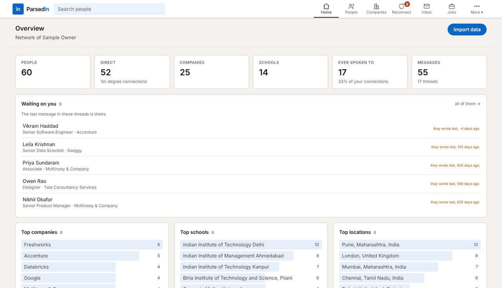
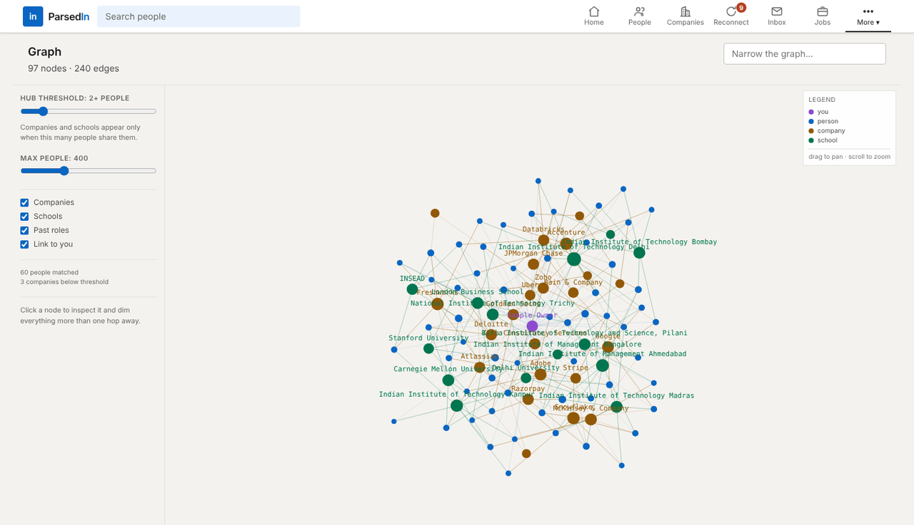
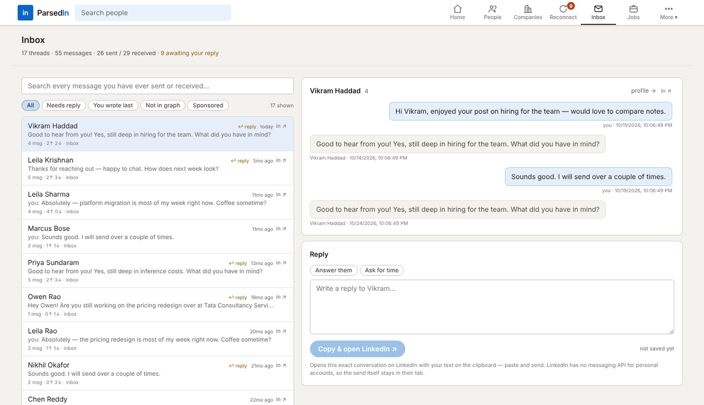

# ParsedIn

A private, local-only knowledge graph of your professional network. Import your
LinkedIn data export and get a searchable, interconnected map of the people,
companies and schools you know — plus private notes and relationship ratings
that never leave your machine.

It reads the whole archive, not just the contact list. The export also contains
every message you have exchanged, every invitation, endorsement, follow, job
application, post and reaction, and the advertising profile LinkedIn built about
you. That half is what separates the people you actually know from the ones you
merely clicked *accept* on — for the network this was built against, 18% of
connections had ever been spoken to.

<!-- showcase -->


| Graph | Inbox with reply drafts |
|---|---|
|  |  |

*Screenshots use the built-in synthetic sample network (Import → Load sample), not real data.*

## Running it

```bash
npm install
npm run app          # http://localhost:3000  — build once, then serve
```

**Use `npm run app`, not `npm run dev`.** `next dev` ships unminified bundles
with source maps and the HMR runtime: about **8.8 MB of JavaScript per page**
against **151 KB gzipped** for a production build. That difference is the whole
reason dev feels sluggish here; it is not the data volume. Reach for `npm run
dev` only when editing code, and rebuild with `npm run app` to use the app.

Building writes to the same `.next/` that a running dev server is serving from,
which breaks it mid-flight (`Cannot find module './331.js'`). If you need to
build while dev is up, send the output elsewhere:

```bash
BUILD_DIR=.next-build npm run build
```

Data lives in `data/parsedin.json` in the project directory. Nothing is sent
anywhere; there are no external API calls at all.

To see the app working before importing anything real, open **Import** and click
**Load sample network** — 60 synthetic people across real company and school
names, loaded through the same pipeline as a genuine import.

## What it does

| Page | Purpose |
| --- | --- |
| **Overview** | Network size, top companies / schools / locations, recent activity |
| **People** | Faceted search: company, previous company, school, location, title, skill, certification, volunteering, industry, connection degree, plus private signals |
| **Person** | Full career and education history, certifications, volunteering, languages, projects, honors — every row showing where it came from |
| **Companies / Schools** | Explore an organization: who is there now, who used to be, where alumni ended up |
| **Graph** | Force-directed map of people, companies and schools with a hub threshold to keep it readable |
| **Ask** | Plain-English questions answered locally, always showing how the question was read |
| **Reconnect** | Relationship health: messages you never answered, real conversations gone quiet, outbound notes that got no reply, and the connections you have never spoken to — with a reply composer on every row |
| **Inbox** | Full-text search over every message you have ever sent or received, with the thread reader and composer beside it |
| **Jobs** | Every role you applied to or saved, joined against the network — *who do I already know here?* |
| **Footprint** | Your posts, comments, reactions, votes, follows, learning and events on one timeline, with monthly cadence |
| **Privacy** | The advertising segments you can be targeted in, the characteristics LinkedIn inferred, and the login / security-challenge log |
| **Import** | Upload archives / CSVs / enriched JSON, with a per-import summary |
| **Sources** | Provenance: every import, what it contributed, which files were read or skipped |

### Questions the Ask page understands

Questions map onto the same filters the People page uses, and the reading is
always displayed, so a misinterpretation is visible rather than mysterious.

Two engines. Without configuration it uses a local rule-based parser and makes
no network calls at all. With Azure OpenAI configured (see below) it uses
gpt-4o for the language, which handles far looser phrasing — *"find me people
who could introduce me to someone at Nvidia"*, *"senior folks in data at
Reliance"*, *"anyone from my old college?"*. The badge on each answer says which
engine produced it, and a **local parser only** checkbox forces the offline
path.

Recognized by both:

- `works at` / `is at` → current employer
- `previously worked at` / `used to work at` / `ex-` → past employer
- `went to` / `studied at` / `graduated from` → school
- `lives in` / `based in` → location
- `knows` / `skilled in` → skills
- `which companies / schools / cities …` → ranked counts
- combine with `and`: *"Who went to IIT and works in AI?"*

Acronyms expand against your data, so **IIT** matches every Indian Institute of
Technology, **TCS** finds Tata Consultancy Services, and spacing variants like
**DY Patil** reach "D Y Patil International University".

## Company resolution

Real exports spell one company several ways and scatter a corporate group across
many legal entities. **Companies → Resolve** cleans this up, using gpt-4o to
adjudicate retrieved web evidence.

Two separate operations, deliberately not conflated:

- **Merge** — the *same* company written differently. `Reliance Jio Infocomm Ltd`
  and `Reliance Jio Infocom Limited`; `Akrudi` and `Akurdi`. Rewrites references
  and absorbs the duplicate. Destructive, so it needs either a web citation or
  names close enough that the spelling itself proves it.
- **Parent link** — genuinely different workplaces in one group. Non-destructive:
  *"who works at JioHotstar"* still answers 8 precisely, while the Reliance group
  rolls up to 81 across 7 entities. A subsidiary is never merged, however
  similar the name looks — merging would destroy which entity someone works at.

```
Reliance Industries Limited [2]
 ├─ Jio Platforms [28]                    Alphabet Inc.
 │   ├─ Jio [32]                           └─ Google [12]
 │   ├─ Reliance Jio Infocom Ltd [3]           ├─ Google Summer of Code [1]
 │   └─ Reliance Jio [2]                       └─ Google Developer Student Clubs [1]
 └─ JioStar [6]
     └─ JioHotstar [8]
```

**Why web evidence rather than model memory.** Asked directly, gpt-4o does not
know JioHotstar, JioStar or JioAds at all, and its answer for Viacom18 is stale —
it reports the Paramount joint venture, missing the 2024 merger into JioStar.
Corporate structure changes faster than a training snapshot, so every
relationship is grounded in retrieved text and carries a citation you can open.
Wikipedia is the default source and needs no key; set `TAVILY_API_KEY` or
`BRAVE_SEARCH_API_KEY` to use a general search API instead.

**Everything is revertible.** Confident conclusions apply automatically, which is
only safe because each one records exactly what it changed — the absorbed company
verbatim, and every person and position whose reference was rewritten. One click
restores it. Uncertain cases queue for review instead.

**Curation survives re-import.** Merges are stored as *rules* keyed on the
normalized name, not as one-off record edits, so importing a later export cannot
resurrect a duplicate you have already dealt with.

How it works: companies are first blocked into candidate clusters locally (shared
rare tokens, brand prefixes, edit distance) — comparing 553 companies pairwise
would be 150k comparisons and an unusable prompt. Each cluster is then grounded
and adjudicated. A final pass reconciles the tops of separate groups, which is
what discovers `Jio Platforms → Reliance Industries`: those two share no
distinctive token, so no cluster could ever contain both.

## Optional: Azure OpenAI

Copy `.env.example` to `.env.local` and fill in:

```
AZURE_OPENAI_ENDPOINT=https://your-resource.openai.azure.com
AZURE_OPENAI_API_KEY=...
AZURE_OPENAI_DEPLOYMENT=gpt-4o        # your deployment name
AZURE_OPENAI_API_VERSION=2024-10-21
```

**What is sent.** Only the question you type, plus your *own* profile's schools
and employers so possessives like "my old college" resolve. No connection of
yours — no names, employers, emails or anything else about them — is ever put in
a prompt. The model's job is purely linguistic: it turns a sentence into a
structured intent naming entities in plain text, and resolving those names
against the actual graph happens locally with the same deterministic code the
offline parser uses. So the model improves language coverage without becoming a
source of truth about your data.

**It is never a dependency.** If the key is missing, wrong, rate-limited or the
request times out, Ask falls back to the local parser, still answers, and shows
what went wrong. Every other page is unaffected.

## Importing

### LinkedIn data export

LinkedIn → *Settings & Privacy* → *Data Privacy* → *Get a copy of your data*.
Ask for **the complete archive**, not the pick-a-few-files option, then drop the
`.zip` straight onto the Import page — no need to unpack it. Loose `.csv` files
work too.

The complete archive matters: LinkedIn's "Basic" download omits `messages.csv`,
the ad profile and the security log entirely, and those are what the Inbox,
Reconnect and Privacy pages are built from.

Recognized files, by what they describe:

| Group | Files |
| --- | --- |
| Your profile | `Profile.csv`, `Email Addresses.csv`, `Positions.csv`, `Education.csv`, `Skills.csv`, `Certifications.csv`, `Volunteering.csv`, `Languages.csv`, `Projects.csv`, `Honors.csv`, `Verifications.csv` |
| Your network | `Connections.csv`, `Invitations.csv`, `Endorsement_Received_Info.csv`, `Endorsement_Given_Info.csv`, `Member_Follows_*.csv`, `Notes.csv` |
| Your activity | `messages.csv`, `Shares_*.csv`, `Comments_*.csv`, `Reactions_*.csv`, `Votes_*.csv`, `Company Follows.csv`, `Learning.csv`, `Events.csv` |
| Job search | `Jobs/Job Applications.csv`, `Jobs/Saved Jobs.csv`, `Jobs/Job Seeker Preferences.csv`, `SavedJobAlerts.csv` |
| Ads & security | `Ad_Targeting.csv`, `Inferences_about_you.csv`, `Ads Clicked.csv`, `LAN Ads Engagement.csv`, `Logins.csv`, `Security Challenges.csv` |

Anything else is reported as skipped rather than silently dropped.

### Reading the activity layer

Three decisions shape what these pages are worth:

- **Companies are linked, never invented.** A company you followed or applied to
  does not enter the registry — that registry means *places people I know work*.
  It links to an existing company when there is one, which is exactly the join
  the Jobs page needs, and stays a plain name otherwise.
- **Sponsored InMail is not correspondence.** LinkedIn files adverts in the same
  archive as real messages, and they are almost all unanswered. Counting them
  would have put 187 threads in "needs a reply" instead of the real 85. They are
  detected, kept, and excluded from every contact figure.
- **Message counterparties become people.** A recruiter who wrote to you is part
  of your network history, so an identified sender gets a record at 2nd degree.
  Senders LinkedIn will not name stay as thread participants rather than
  becoming records that could never be merged confidently later.

### Opening someone's profile

Every person in the graph carries an `in ↗` link straight to their real LinkedIn
page — in the People list, on company and school pages, in Ask results, on
Reconnect rows, in the Inbox thread list and header, and on their own profile.
Records that arrived without a profile URL fall back to a `⌕ ↗` name search, so
no row is a dead end.

One wrinkle worth knowing about, since it silently breaks links: sources
disagree on whether to include the scheme. `Connections.csv` writes
`https://www.linkedin.com/in/x`, the endorsement files write
`www.linkedin.com/in/x` — and a bare host in an `href` is a *relative* path, so
the second form navigates to `localhost:3000/www.linkedin.com/in/x` and 404s.
URLs are canonicalized on import, healed on load for documents written before
that, and normalized again at render, which also rejects anything that is not
actually a host.

### Replying

You can write a reply anywhere a person appears — the Inbox thread, their
profile, or inline on a Reconnect row. **Copy & open LinkedIn** puts the text on
your clipboard and opens that exact conversation; paste and send. Drafts persist
between sessions, and **Mark as sent** records the reply so Reconnect stops
flagging the thread and the contact signal reflects it.

**The app cannot send the message itself, and that is a hard limit rather than a
missing feature.** Three things rule it out:

- LinkedIn publishes no messaging API for personal accounts. The Messages API is
  partner-only and covers company pages.
- Being signed in to LinkedIn in the same browser does not help. Cookies are
  scoped to their origin and LinkedIn sends no CORS headers for `localhost`, so
  a `fetch()` from this app is refused before it is ever authenticated.
- The remaining routes — copying your `li_at` session cookie into the app, or
  driving a headless browser — impersonate your account against an undocumented
  endpoint. LinkedIn detects both and restricts accounts for it, which is a poor
  trade for saving one paste.

So the app owns everything up to the send: composing with the whole relationship
in view, keeping the draft, and remembering that you replied — which is the one
contact fact the export can never contain, because it happened after the archive
was downloaded.

### Contact signal

Each person gets a 0–100 score for how much evidence the archive holds for a
relationship — not a guess at how close you are. Message volume counts
logarithmically (the tenth message says far less than the second), reciprocity
is weighted heavily (a one-sided thread is usually a pitch), endorsements add a
little, and the whole thing decays with a roughly one-year half-life, because a
conversation from 2021 is history rather than a relationship. It sits beside
your own private 1–5 rating on each profile; the two disagree more often than
you would expect, which is the useful part.

### The limitation that shapes this product

**LinkedIn's export contains rich history only for you.** For your connections
it provides just name, profile URL, email, current company, current title and
the date you connected — no career history, no education, no skills.

So the archive importer fills out your own profile completely and creates a
lightweight record per connection. To get real depth on the people in your
network, layer in an **enriched profile JSON** import. Records merge onto
existing people by LinkedIn URL first and name second, so enrichment deepens
what you already have instead of duplicating it. Download a template from the
Import page.

### Merge behaviour

Imports are additive and idempotent — re-importing the same archive refreshes
provenance timestamps without duplicating anyone. Specifically:

- People match on normalized LinkedIn URL, then on name; ambiguous name-only
  matches create a new record rather than guessing.
- `Google`, `Google Inc.` and `Google LLC` collapse to one company; the
  shortest surface form becomes the display name and the rest are kept as
  aliases.
- A dateless role from `Connections.csv` is absorbed by the dated version of the
  same role once a richer source supplies it.
- Empty incoming values never erase what is already known.

## Provenance

Every imported fact records the import batch that introduced it and when. On a
person's profile the small ⓘ beside a field reveals the exact source file and
import time; history rows carry the same footer. **Sources** shows the full
import history and which files each batch read or skipped.

Notes, relationship ratings and reply drafts are private: never produced by an import, never
included in one, and preserved when you clear imported data.

## Look and feel

The UI follows LinkedIn's own visual language: the warm off-white page
(`#f4f2ee`), white hairline cards, LinkedIn blue (`#0a66c2`), pill buttons, one
system sans throughout, and a top nav with icon-over-label tabs and a rule under
the active one. Six destinations are tabs; the rest sit behind **More**, which
is how LinkedIn handles the same crowding.

Tokens live in `tailwind.config.ts` and are named by role — `canvas`, `surface`,
`line`, `fg-muted`, `brand` — rather than by shade. The app was authored
dark-first, so a literal palette would have left `slate-600` meaning "the
faintest text", which is a trap for whoever edits it next. Every foreground tone
is AA on white at body size (`fg` 16.9:1 down to `fg-faint` 4.5:1), so the quiet
metadata stays legible instead of merely decorative.

Two details worth keeping if you restyle further:

- **Monospace is reserved for machine text** — IPs, user agents, file names,
  record ids, JSON. It was previously used for all metadata, and that single
  choice was the loudest signal that this was not LinkedIn.
- **Everyone has an avatar.** The export ships no photos for connections, so
  `Avatar` draws initials on a tint derived from the name. A long list is
  scannable by shape as well as by reading, which is most of what the real
  photos are doing.

The graph canvas repeats the node palette as hex, since canvas cannot read
Tailwind classes; `tailwind.config.ts` and `GraphCanvas.tsx` have to be changed
together.

## Architecture

```
src/lib/
  types.ts          domain model
  db.ts             the only module touching the filesystem
  entities.ts       company / school registries
  normalize.ts      name, company, URL and date normalization
  match.ts          word-boundary and acronym matching
  derive.ts         read-side projections and lookup indexes
  contact.ts        contact stats, signal strength, relationship health
  linkedin.ts       deep links back into LinkedIn, and why they are links
  graph.ts          graph projection
  ingest/           csv reader, entity merge, LinkedIn profile + activity +
                    enriched importers
  query/            filters, facets, question parser, aggregations
  llm/              optional Azure OpenAI client and question translator
src/app/api/        dataset, import, sample, reset, notes, relationship,
                    drafts, ask
```

The client fetches the whole database once and does all filtering, graphing and
question answering in memory — appropriate for a personal network and it keeps
the UI instant. Storage is a single JSON document; `db.ts` is the only file that
would change to move to SQLite.

On payload size, measured against a real 862-person network with its full
activity archive: the dataset is 3.7 MB of JSON and compresses to ~270 KB.
Provenance timestamps and batch ids repeat on every record and compress ~15:1;
message bodies are the part that does not, which is the price of a searchable
inbox. `/api/dataset` gzips explicitly rather than relying on the server's own
compression, so this applies in development too. The client-side hot paths stay
cheap (full-text corpus over 862 people, ~1 ms; contact stats over 253 threads,
sub-millisecond), so there is no reason to page or shard any of it at this
scale.

Deliberately not built, but left room for: scraping, sending messages, calendar
integration, AI outreach. The ingest layer is source-agnostic (any importer
produces the same provenanced records), and mutations already go through API
routes, so those are additive rather than structural changes.

## Notes

- No tests, no auth, no multi-user support — this is a single-user local tool.
- The graph simulation caps at a configurable number of people; raise the cap in
  the sidebar if you want more on screen at once.
